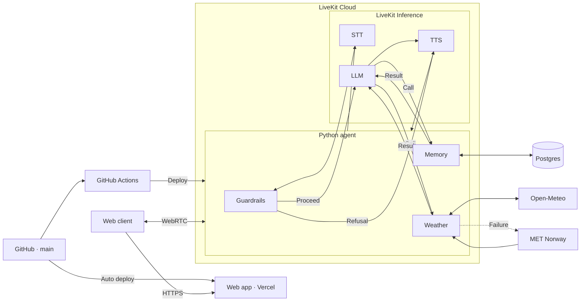
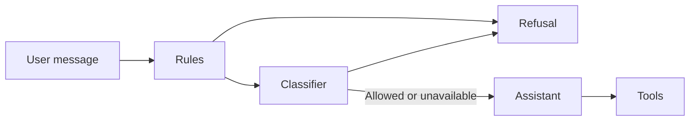

# Voice Assistant with Memory

[Live demo](https://ai-voice-assistant-pi-one.vercel.app/)

A personalized voice assistant with persistent memory and weather tools.
Talk to it in real time; no sign-up needed.

## Features

- **Voice conversation:** talk naturally, with live captions and microphone controls.
- **Persistent memory:** save, update and forget facts; return from the same browser
  to continue with remembered preferences.
- **Weather:** current conditions and forecasts, with a secondary forecast provider
  when the primary fails.
- **Visible outcomes:** the memory panel reflects saved facts and changes.
- **Guardrails:** topic checks, user-scoped memory and tool-backed answers.
- **Appearance:** light, dark and system theme options, with an animated voice indicator.

Try: “Remember my favorite color is teal,” then reconnect and ask,
“What’s my favorite color?”

## Architecture



## How it works

A call, step by step:

1. The browser asks `/api/token` for a token. The route reads (or creates) the
   guest cookie and signs a short-lived token with that identity, and dispatches
   the agent.
2. The browser joins a LiveKit room. The agent joins the same room, reads the
   user's identity from the token and loads their saved facts.
3. Speech goes through STT → topic guardrails → LLM → TTS. The LLM calls tools for memory and
   weather, and every tool result is also sent to the UI as an event.

- **Voice providers:** the default pipeline uses LiveKit Inference. STT, LLM
  and TTS models are configured independently through `STT_MODEL`, `LLM_MODEL`
  and `TTS_MODEL`, keeping memory and weather logic independent of model providers.
  Provider compatibility includes tool use and turn handling.
  Gemini Live is an optional speech-to-speech integration. It does not run the
  same topic checks as the default pipeline, so it requires an explicit opt-in.
- **Identity:** each browser gets an anonymous guest ID in an HttpOnly cookie.
  The token route turns it into the LiveKit participant identity, and the agent
  uses that identity as the memory owner. Nothing is stored per visit, only
  facts the user asks the assistant to remember.
- **Memory:** saved facts are loaded as soon as a call starts. The assistant can
  greet a returning user by name, and the memory panel opens without waiting on
  the database. Changes are pushed to the UI as they happen.
- **Weather:** current conditions plus today and tomorrow. If Open-Meteo times
  out or fails, the agent falls back to MET Norway. Weather adapters share a
  service interface; another provider needs an adapter for its response format,
  rather than just a different endpoint URL.

## Safeguards

The pipeline combines topic checks with validation in the memory and weather services:



| Concern | Safeguard |
| --- | --- |
| Topics and jailbreaks | Rules and a classifier check user turns before the main LLM. Blocked turns receive a fixed refusal. |
| Memory isolation | Signed guest identity, user-scoped queries and caller-checked memory access. |
| Stored facts | Pattern screening and explicit separation of stored data from instructions. |
| Tool outcomes | The UI reflects service results; uncertain writes are checked against storage. |
| Weather | Responses use returned values and source attribution; upstream failures trigger forecast fallback. |
| Session recording | Agent sessions start with recording disabled. |
| Retention | Saved facts expire after the configured period of inactivity. |

**Trade-offs.** The classifier adds one short LLM call before every reply, and
the red-team run measures it. If the classifier times out (`GUARD_TIMEOUT_S`),
the turn is allowed so the assistant stays usable; the rules, the prompt policy
and the code-level checks still apply. `GUARD_MODE=rules` removes the added
latency at the cost of catching less. A speech-to-speech model
(`VOICE_PROVIDER=gemini_live`) detects turns and answers on its own, so the gate
can't run. The agent refuses to start that way unless `ALLOW_UNGATED_REALTIME=true`
is set, which accepts prompt-only topic guardrails (identity and storage checks
still apply).

### Red-team evaluation

The evaluation in `agent/evals` covers prohibited requests, jailbreak attempts,
memory isolation, tool outages and harmless requests. It checks the topic gate
and agent responses using text input, simulated services and a mix of code
checks and an LLM judge. It does not test live audio or deployed infrastructure.

```sh
cd agent
uv run python evals/redteam.py
```

## Run locally

You need:

- Python 3.11+ and [uv](https://docs.astral.sh/uv/)
- Node 24 and pnpm 9
- A LiveKit Cloud project
- A Postgres database (Neon's free tier works)

Environment examples list the required LiveKit credentials, database connection
and guest-signing secret. The agent and web app use the same LiveKit project.

**Agent**

```sh
cd agent
cp .env.example .env
uv sync
uv run python db/migrate.py
uv run voice-agent dev
```

**Web**

```sh
cd web
cp .env.example .env.local
pnpm install
pnpm dev                    # http://localhost:3000
```

## Configuration

| Variable                                           | Where         | Purpose                                                                           |
| -------------------------------------------------- | ------------- | --------------------------------------------------------------------------------- |
| `APP_NAME`                                         | agent         | Name the assistant introduces itself with                                         |
| `NEXT_PUBLIC_APP_NAME`                             | web           | UI display name (build time)                    |
| `AGENT_NAME`                                       | agent and web | Shared agent dispatch name                    |
| `GUEST_ID_SECRET`                                  | web           | Guest cookie signing secret (minimum 32 characters) |
| `VOICE_PROVIDER`                                   | agent         | `livekit_pipeline` (default) or `gemini_live`                                     |
| `STT_MODEL`, `LLM_MODEL`, `TTS_MODEL`, `TTS_VOICE` | agent         | Models for the default pipeline                                                   |
| `DATABASE_URL`                                     | agent         | Postgres connection string            |
| `DB_CONNECT_TIMEOUT_S`                             | agent         | Connect timeout; long enough for a sleeping database to wake                      |
| `DB_TIMEOUT_S`                                     | agent         | Per-query timeout                                                                 |
| `MEMORY_RETENTION_DAYS`                            | agent         | Days without a call before a guest's facts are deleted (`0` keeps them)           |
| `GUARD_MODE`                                       | agent         | Topic gate: `classifier` (default), `rules` or `off`                              |
| `GUARD_MODEL`, `GUARD_TIMEOUT_S`                   | agent         | Classifier model (defaults to `LLM_MODEL`) and its timeout                        |

See `agent/.env.example` and `web/.env.example` for the full list.

## Data model

One table, `memories`: one row per user and fact.

| Column                     | Notes                                                                        |
| -------------------------- | ---------------------------------------------------------------------------- |
| `user_id`, `key`           | Unique together. This index serves every per-user lookup, update and delete. |
| `value`                    | Up to 500 characters; sensitive values are refused before storage.           |
| `created_at`, `updated_at` | Audit timestamps.                                                            |
| `last_seen_at`             | Set when the user starts a call; indexed for the retention sweep.            |

Migrations live in `agent/db/migrations` and are idempotent. The agent applies
them on start, and `db/migrate.py` provides a standalone migration command.

Postgres provides durable facts across sessions, with scoped updates and deletions.
Retention is based on the guest's most recent call.

## Tests

Set `FAULT_DB_WRITE=true` to simulate storage write failures or `FAULT_WEATHER=true`
to simulate primary weather failures and test forecast fallback.

```sh
cd agent
uv run pytest
RUN_WEATHER_INTEGRATION=1 uv run pytest tests/test_weather_integration.py   # live weather APIs
```

## Deployment

The web app runs on **Vercel**, the voice agent on **LiveKit Cloud**, and memory
on **Neon Postgres**. Vercel deploys from `main`; GitHub Actions tests changes
and deploys agent updates. Token requests are rate-limited in Vercel Firewall.

See the [deployment overview](docs/deployment.md) for hosting and operations.

## Limits

- Guest identity lives in one browser. Clearing cookies starts a new guest, and
  memory can't be carried to another device yet.
- Weather covers today and tomorrow only.
- No guardrail stops every jailbreak. The gate and prompt reduce the chance; the
  evaluation exercises known attack patterns. Identity, storage scoping and
  tool results are enforced in code and don't depend on the model.
- The topic rules are English-only; other languages rely on the classifier.

## Credits

- [LiveKit agent-starter-react](https://github.com/livekit-examples/agent-starter-react)
  (MIT): the frontend starting point and voice UI integration.
- [LiveKit Agents](https://github.com/livekit/agents): voice pipeline orchestration.
- [next-themes](https://github.com/pacocoursey/next-themes): light, dark and system themes.
- [Motion](https://github.com/motiondivision/motion): interface animations.
- [Phosphor Icons](https://github.com/phosphor-icons/react): interface icons.
- [Open-Meteo](https://open-meteo.com/): primary weather data.
- [MET Norway](https://www.met.no/): fallback forecast data, used under
  [CC BY 4.0](https://creativecommons.org/licenses/by/4.0/).
