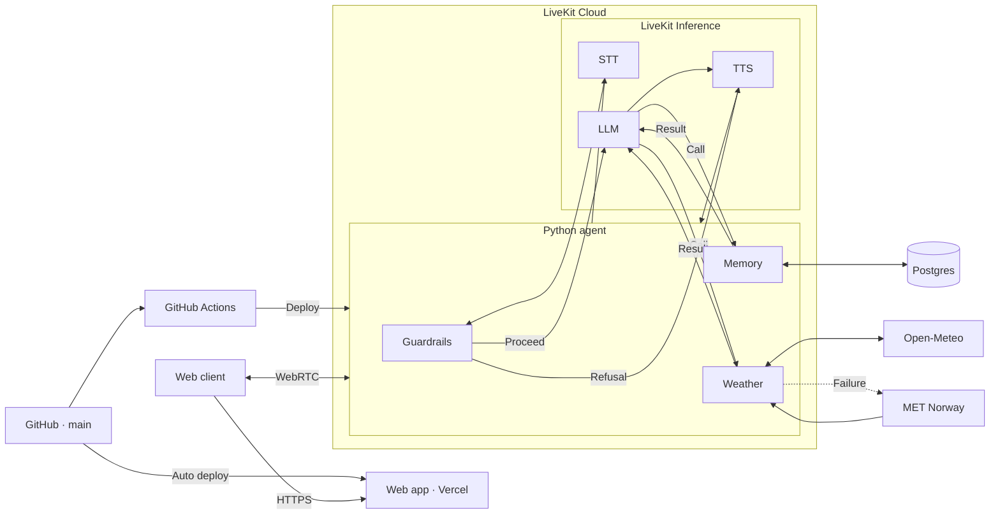
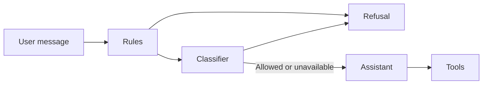

# Voice Assistant with Memory

[Live demo](https://ai-voice-assistant-pi-one.vercel.app/)

A personalized voice assistant with persistent memory and weather tools.
Talk to it in real time; no sign-up needed.

## Features

- **Voice conversation:** talk naturally, with live captions and microphone controls.
- **Persistent memory:** save, update and forget facts; return from the same browser
  to continue with remembered preferences.
- **Weather:** current conditions and forecasts, with a secondary forecast provider
  when the primary fails.
- **Visible outcomes:** the memory panel reflects saved facts and changes.
- **Guardrails:** topic checks, user-scoped memory and tool-backed answers.

Try: “Remember my favorite color is teal,” then reconnect and ask,
“What’s my favorite color?”

## Architecture



## How it works

A call, step by step:

1. The browser asks `/api/token` for a token. The route reads (or creates) the
   guest cookie and signs a short-lived token with that identity, and dispatches
   the agent.
2. The browser joins a LiveKit room. The agent joins the same room, reads the
   user's identity from the token and loads their saved facts.
3. Speech goes through STT → topic guardrails → LLM → TTS. The LLM calls tools for memory and
   weather, and every tool result is also sent to the UI as an event.

- **Voice:** by default, speech-to-text → LLM → text-to-speech through LiveKit
  Inference. Set `VOICE_PROVIDER` to use a realtime speech-to-speech model
  (Gemini Live) instead.
- **Identity:** each browser gets an anonymous guest ID in an HttpOnly cookie.
  The token route turns it into the LiveKit participant identity, and the agent
  uses that identity as the memory owner. Nothing is stored per visit, only
  facts the user asks the assistant to remember.
- **Memory:** saved facts are loaded as soon as a call starts. The assistant can
  greet a returning user by name, and the memory panel opens without waiting on
  the database. Changes are pushed to the UI as they happen.
- **Weather:** current conditions plus today and tomorrow. If Open-Meteo times
  out or fails, the agent falls back to MET Norway.

## Guardrails and reliability

Each guardrail sits in code where it can, and in the prompt only where it must:



| Concern                           | What the code does                                                                                                                                                                                                                                                                                                                              |
| --------------------------------- | ----------------------------------------------------------------------------------------------------------------------------------------------------------------------------------------------------------------------------------------------------------------------------------------------------------------------------------------------- |
| Prohibited topics                 | A gate checks every user turn before the main LLM sees it: high-precision rules first (instant), then a separate classifier call that returns one label. A blocked turn gets a fixed, kind refusal (self-harm gets a supportive one that points to help) and never reaches the main model. The policy is also in the main model's instructions. |
| Jailbreaks                        | The same gate labels attempts to change the rules, reveal the instructions, claim developer authority, or use role-play or hypotheticals to get around the policy. The instructions say they can't be changed by anything in the conversation.                                                                                                  |
| Memory belongs to the right user  | The guest cookie is signed by the server (HMAC), so an ID can't be forged or reused from another browser. Tools never accept a user ID; it comes from the signed LiveKit token. Every query is scoped to it, and the memory RPC rejects any other caller. Asking for someone else's data can't work, whatever the model does.                   |
| Stored text can't steer the model | Facts that look like instructions are refused before storage. Saved facts are placed in a fenced block, one line each, marked as data only.                                                                                                                                                                                                     |
| No false "saved" claims           | Tools return structured results (`ok`, `error_code`). The assistant may only claim a change when `ok=true`. The UI shows the real result, not the model's words.                                                                                                                                                                                |
| Sensitive data                    | Passwords, card numbers and ID numbers are refused before storage.                                                                                                                                                                                                                                                                              |
| Grounded weather                  | Answers come only from tool data, with the source named. Missing values are reported as unavailable, not guessed.                                                                                                                                                                                                                               |
| Honest failures                   | Short query timeouts. A timed-out write is reported as "couldn't confirm", then read back from storage and reported as it really is. Storage and weather failures are spoken and shown in the UI. Changes made while memory is loading (including deletions) always win over the older snapshot.                                                |
| Nothing kept by LiveKit           | Sessions start with recording off, so no audio, transcripts or traces are stored in LiveKit Cloud.                                                                                                                                                                                                                                              |
| Data retention                    | A guest's facts are deleted after `MEMORY_RETENTION_DAYS` (default 365) without a call, matching the one-year guest cookie. The agent runs this in the background, at most once a day.                                                                                                                                                          |
| Fault injection                   | `FAULT_DB_WRITE=true` and `FAULT_WEATHER=true` simulate outages for demos and tests.                                                                                                                                                                                                                                                            |

**Trade-offs.** The classifier adds one short LLM call before every reply, and
the red-team run measures it. If the classifier times out (`GUARD_TIMEOUT_S`),
the turn is allowed so the assistant stays usable; the rules, the prompt policy
and the code-level checks still apply. `GUARD_MODE=rules` removes the added
latency at the cost of catching less. A speech-to-speech model
(`VOICE_PROVIDER=gemini_live`) detects turns and answers on its own, so the gate
can't run. The agent refuses to start that way unless `ALLOW_UNGATED_REALTIME=true`
is set, which accepts prompt-only topic guardrails (identity and storage checks
still apply).

### Red-team evaluation

The evaluation in `agent/evals` covers prohibited requests, jailbreak attempts,
memory isolation, tool outages and harmless requests. It checks the topic gate
and agent responses using text input, simulated services and a mix of code
checks and an LLM judge. It does not test live audio or deployed infrastructure.

```sh
cd agent
uv run python evals/redteam.py
```

## Run locally

You need:

- Python 3.11+ and [uv](https://docs.astral.sh/uv/)
- Node 24 and pnpm 9
- A LiveKit Cloud project
- A Postgres database (Neon's free tier works)

**Agent**

```sh
cd agent
cp .env.example .env        # fill in LiveKit keys and DATABASE_URL
uv sync
uv run python db/migrate.py
uv run voice-agent dev
```

**Web**

```sh
cd web
cp .env.example .env.local  # same LiveKit keys
pnpm install
pnpm dev                    # http://localhost:3000
```

## Configuration

| Variable                                           | Where         | Purpose                                                                           |
| -------------------------------------------------- | ------------- | --------------------------------------------------------------------------------- |
| `APP_NAME`                                         | agent         | Name the assistant introduces itself with                                         |
| `NEXT_PUBLIC_APP_NAME`                             | web           | Name shown in the UI (build time); keep it equal to `APP_NAME`                    |
| `AGENT_NAME`                                       | agent and web | LiveKit agent name used for dispatch; must match on both sides                    |
| `GUEST_ID_SECRET`                                  | web           | Signs the guest cookie; at least 32 random characters (`openssl rand -base64 32`) |
| `VOICE_PROVIDER`                                   | agent         | `livekit_pipeline` (default) or `gemini_live`                                     |
| `STT_MODEL`, `LLM_MODEL`, `TTS_MODEL`, `TTS_VOICE` | agent         | Models for the default pipeline                                                   |
| `DATABASE_URL`                                     | agent         | Postgres connection string (for Neon, drop `&channel_binding=require`)            |
| `DB_CONNECT_TIMEOUT_S`                             | agent         | Connect timeout; long enough for a sleeping database to wake                      |
| `DB_TIMEOUT_S`                                     | agent         | Per-query timeout                                                                 |
| `MEMORY_RETENTION_DAYS`                            | agent         | Days without a call before a guest's facts are deleted (`0` keeps them)           |
| `GUARD_MODE`                                       | agent         | Topic gate: `classifier` (default), `rules` or `off`                              |
| `GUARD_MODEL`, `GUARD_TIMEOUT_S`                   | agent         | Classifier model (defaults to `LLM_MODEL`) and its timeout                        |

See `agent/.env.example` and `web/.env.example` for the full list.

## Data model

One table, `memories`: one row per user and fact.

| Column                     | Notes                                                                        |
| -------------------------- | ---------------------------------------------------------------------------- |
| `user_id`, `key`           | Unique together. This index serves every per-user lookup, update and delete. |
| `value`                    | Up to 500 characters; sensitive values are refused before storage.           |
| `created_at`, `updated_at` | Audit timestamps.                                                            |
| `last_seen_at`             | Set when the user starts a call; indexed for the retention sweep.            |

Migrations live in `agent/db/migrations` and are idempotent. The agent applies
them on start, and `db/migrate.py` applies them by hand.

**Why Postgres and not Redis with a TTL?** Memory must survive across sessions,
so it belongs in a database, not a cache. Correcting and forgetting are each a
single checked SQL statement ("only if it exists", "report whether it existed").
Expiry is handled by the retention rule above.

## Tests

```sh
cd agent
uv run pytest
RUN_WEATHER_INTEGRATION=1 uv run pytest tests/test_weather_integration.py   # live weather APIs
```

## Deployment

The web app runs on **Vercel**, the voice agent on **LiveKit Cloud**, and memory
on **Neon Postgres**. Vercel deploys from `main`; GitHub Actions tests changes
and deploys agent updates. Token requests are rate-limited in Vercel Firewall.

See [deployment setup and monitoring](docs/deployment.md) for configuration and commands.

## Limits

- Guest identity lives in one browser. Clearing cookies starts a new guest, and
  memory can't be carried to another device yet.
- Weather covers today and tomorrow only.
- No guardrail stops every jailbreak. The gate and prompt reduce the chance; the
  red-team results show what still gets through. Identity, storage scoping and
  tool results are enforced in code and don't depend on the model.
- The topic rules are English-only; other languages rely on the classifier.

## Credits

The web app started from LiveKit's
[agent-starter-react](https://github.com/livekit-examples/agent-starter-react)
(MIT). MET Norway data is used under [CC BY 4.0](https://creativecommons.org/licenses/by/4.0/).
