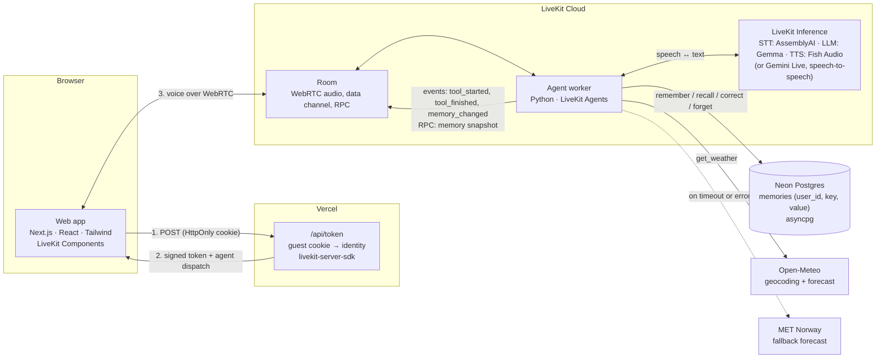

# Voice Assistant with Memory

A browser voice assistant that remembers what you tell it across visits and can
check the weather. Talk to it in real time; no sign-up needed.

## How it works



A call, step by step:

1. The browser asks `/api/token` for a token. The route reads (or creates) the
   guest cookie and signs a short-lived token with that identity, and dispatches
   the agent.
2. The browser joins a LiveKit room. The agent joins the same room, reads the
   user's identity from the token and loads their saved facts.
3. Speech goes through STT → LLM → TTS. The LLM calls tools for memory and
   weather, and every tool result is also sent to the UI as an event.

- **Voice:** by default, speech-to-text → LLM → text-to-speech through LiveKit
  Inference. Set `VOICE_PROVIDER` to use a realtime speech-to-speech model
  (Gemini Live) instead.
- **Identity:** each browser gets an anonymous guest ID in an HttpOnly cookie.
  The token route turns it into the LiveKit participant identity, and the agent
  uses that identity as the memory owner. Nothing is stored per visit, only
  facts the user asks the assistant to remember.
- **Memory:** saved facts are loaded as soon as a call starts. The assistant can
  greet a returning user by name, and the memory panel opens without waiting on
  the database. Changes are pushed to the UI as they happen.
- **Weather:** current conditions plus today and tomorrow. If Open-Meteo times
  out or fails, the agent falls back to MET Norway.

## Guardrails and reliability

| Concern | What the code does |
| --- | --- |
| Memory belongs to the right user | Tools never accept a user ID; it comes from the signed LiveKit token. The memory RPC rejects any caller other than the session's user. |
| No false "saved" claims | Tools return structured results (`ok`, `error_code`). The assistant may only claim a change when `ok=true`. The UI shows the real result, not the model's words. |
| Sensitive data | Passwords, card numbers and ID numbers are refused before storage. |
| Stored text can't steer the model | Facts are placed in a fenced block, one line each, marked as data only. |
| Grounded weather | Answers come only from tool data, with the source named. Missing values are reported as unavailable, not guessed. |
| Honest failures | Short query timeouts. Storage and weather failures are spoken and shown in the UI. |
| Fault injection | `FAULT_DB_WRITE=true` and `FAULT_WEATHER=true` simulate outages for demos and tests. |

## Run locally

You need:
- Python 3.11+ and [uv](https://docs.astral.sh/uv/)
- Node 24 and pnpm 9
- A LiveKit Cloud project
- A Postgres database (Neon's free tier works)

**Agent**

```sh
cd agent
cp .env.example .env        # fill in LiveKit keys and DATABASE_URL
uv sync
uv run python db/migrate.py
uv run voice-agent dev
```

**Web**

```sh
cd web
cp .env.example .env.local  # same LiveKit keys
pnpm install
pnpm dev                    # http://localhost:3000
```

## Configuration

| Variable | Where | Purpose |
| --- | --- | --- |
| `APP_NAME` | agent | Name the assistant introduces itself with |
| `NEXT_PUBLIC_APP_NAME` | web | Name shown in the UI (build time); keep it equal to `APP_NAME` |
| `AGENT_NAME` | agent and web | LiveKit agent name used for dispatch; must match on both sides |
| `VOICE_PROVIDER` | agent | `livekit_pipeline` (default) or `gemini_live` |
| `STT_MODEL`, `LLM_MODEL`, `TTS_MODEL`, `TTS_VOICE` | agent | Models for the default pipeline |
| `DATABASE_URL` | agent | Postgres connection string (for Neon, drop `&channel_binding=require`) |
| `DB_CONNECT_TIMEOUT_S` | agent | Connect timeout; long enough for a sleeping database to wake |
| `DB_TIMEOUT_S` | agent | Per-query timeout |

See `agent/.env.example` and `web/.env.example` for the full list.

## Tests

```sh
cd agent
uv run pytest
RUN_WEATHER_INTEGRATION=1 uv run pytest tests/test_weather_integration.py   # live weather APIs
```

## Deploy

- **Web:** Vercel, with root directory `web` and the variables from `web/.env.example`.
- **Agent:** LiveKit Cloud agents (`lk agent create` from `agent/`, which builds
  its Dockerfile). Set the agent's variables as secrets.

## Limits

- Guest identity lives in one browser. Clearing cookies starts a new guest, and
  memory can't be carried to another device yet.
- Weather covers today and tomorrow only.
- Prompt-level rules reduce the chance that the model ignores instructions but
  don't eliminate it. The code-level checks above don't depend on the model.

## Credits

The web app started from LiveKit's
[agent-starter-react](https://github.com/livekit-examples/agent-starter-react)
(MIT). MET Norway data is used under [CC BY 4.0](https://creativecommons.org/licenses/by/4.0/).
