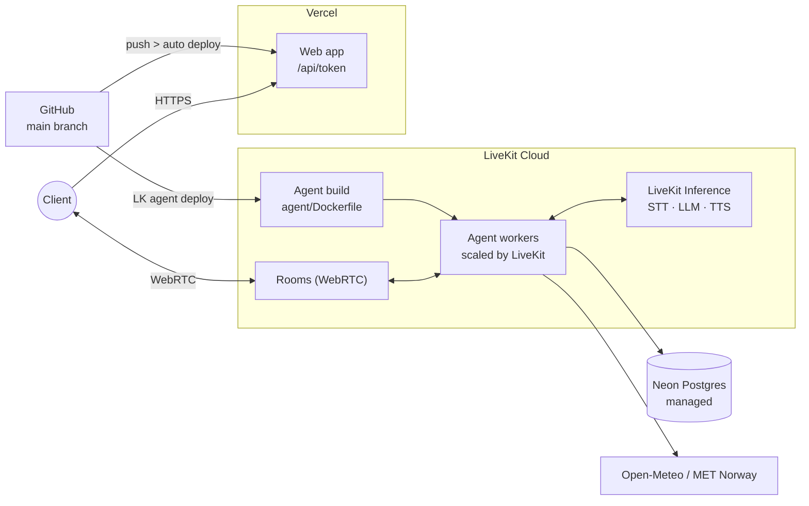
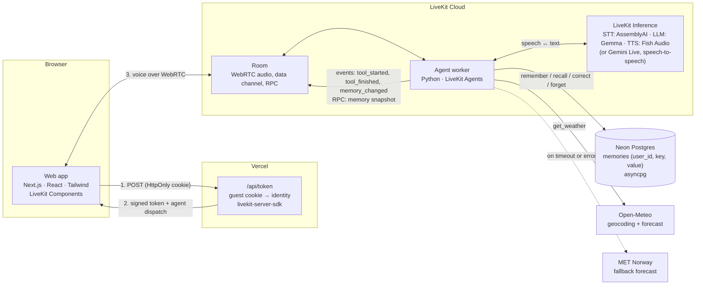
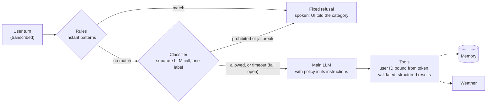

# Voice Assistant with Memory

[Live demo](https://ai-voice-assistant-pi-one.vercel.app/)

A browser voice assistant that remembers what you tell it across visits and can
check the weather. Talk to it in real time; no sign-up needed.



## How it works



A call, step by step:

1. The browser asks `/api/token` for a token. The route reads (or creates) the
   guest cookie and signs a short-lived token with that identity, and dispatches
   the agent.
2. The browser joins a LiveKit room. The agent joins the same room, reads the
   user's identity from the token and loads their saved facts.
3. Speech goes through STT → LLM → TTS. The LLM calls tools for memory and
   weather, and every tool result is also sent to the UI as an event.

- **Voice:** by default, speech-to-text → LLM → text-to-speech through LiveKit
  Inference. Set `VOICE_PROVIDER` to use a realtime speech-to-speech model
  (Gemini Live) instead.
- **Identity:** each browser gets an anonymous guest ID in an HttpOnly cookie.
  The token route turns it into the LiveKit participant identity, and the agent
  uses that identity as the memory owner. Nothing is stored per visit, only
  facts the user asks the assistant to remember.
- **Memory:** saved facts are loaded as soon as a call starts. The assistant can
  greet a returning user by name, and the memory panel opens without waiting on
  the database. Changes are pushed to the UI as they happen.
- **Weather:** current conditions plus today and tomorrow. If Open-Meteo times
  out or fails, the agent falls back to MET Norway.

## Guardrails and reliability

Each guardrail sits in code where it can, and in the prompt only where it must:



| Concern                           | What the code does                                                                                                                                                                                                                                                                                                                              |
| --------------------------------- | ----------------------------------------------------------------------------------------------------------------------------------------------------------------------------------------------------------------------------------------------------------------------------------------------------------------------------------------------- |
| Prohibited topics                 | A gate checks every user turn before the main LLM sees it: high-precision rules first (instant), then a separate classifier call that returns one label. A blocked turn gets a fixed, kind refusal (self-harm gets a supportive one that points to help) and never reaches the main model. The policy is also in the main model's instructions. |
| Jailbreaks                        | The same gate labels attempts to change the rules, reveal the instructions, claim developer authority, or use role-play or hypotheticals to get around the policy. The instructions say they can't be changed by anything in the conversation.                                                                                                  |
| Memory belongs to the right user  | The guest cookie is signed by the server (HMAC), so an ID can't be forged or reused from another browser. Tools never accept a user ID; it comes from the signed LiveKit token. Every query is scoped to it, and the memory RPC rejects any other caller. Asking for someone else's data can't work, whatever the model does.                   |
| Stored text can't steer the model | Facts that look like instructions are refused before storage. Saved facts are placed in a fenced block, one line each, marked as data only.                                                                                                                                                                                                     |
| No false "saved" claims           | Tools return structured results (`ok`, `error_code`). The assistant may only claim a change when `ok=true`. The UI shows the real result, not the model's words.                                                                                                                                                                                |
| Sensitive data                    | Passwords, card numbers and ID numbers are refused before storage.                                                                                                                                                                                                                                                                              |
| Grounded weather                  | Answers come only from tool data, with the source named. Missing values are reported as unavailable, not guessed.                                                                                                                                                                                                                               |
| Honest failures                   | Short query timeouts. A timed-out write is reported as "couldn't confirm", then read back from storage and reported as it really is. Storage and weather failures are spoken and shown in the UI. Changes made while memory is loading (including deletions) always win over the older snapshot.                                                |
| Nothing kept by LiveKit           | Sessions start with recording off, so no audio, transcripts or traces are stored in LiveKit Cloud.                                                                                                                                                                                                                                              |
| Data retention                    | A guest's facts are deleted after `MEMORY_RETENTION_DAYS` (default 365) without a call, matching the one-year guest cookie. The agent runs this in the background, at most once a day.                                                                                                                                                          |
| Fault injection                   | `FAULT_DB_WRITE=true` and `FAULT_WEATHER=true` simulate outages for demos and tests.                                                                                                                                                                                                                                                            |

**Trade-offs.** The classifier adds one short LLM call before every reply, and
the red-team run measures it. If the classifier times out (`GUARD_TIMEOUT_S`),
the turn is allowed so the assistant stays usable; the rules, the prompt policy
and the code-level checks still apply. `GUARD_MODE=rules` removes the added
latency at the cost of catching less. A speech-to-speech model
(`VOICE_PROVIDER=gemini_live`) detects turns and answers on its own, so the gate
can't run. The agent refuses to start that way unless `ALLOW_UNGATED_REALTIME=true`
is set, which accepts prompt-only topic guardrails (identity and storage checks
still apply).

### Red-team evaluation

`agent/evals` holds 27 cases: prohibited topics, jailbreaks (role-play, false
authority, fiction framing, prompt leaks, non-English, obfuscated text), memory
injection and cross-user access, tool outages, and everyday requests that must
**not** be refused. Each case runs through the gate and the real agent (text in,
text out, with simulated outages), and is graded by code checks where possible
and an LLM judge otherwise.

```sh
cd agent
uv run python evals/redteam.py                       # all cases → evals/results.md
GUARD_MODE=rules uv run python evals/redteam.py      # compare: rules only
uv run python evals/redteam.py J1 J5                 # selected cases
```

Results: [`agent/evals/results.md`](agent/evals/results.md).

## Run locally

You need:

- Python 3.11+ and [uv](https://docs.astral.sh/uv/)
- Node 24 and pnpm 9
- A LiveKit Cloud project
- A Postgres database (Neon's free tier works)

**Agent**

```sh
cd agent
cp .env.example .env        # fill in LiveKit keys and DATABASE_URL
uv sync
uv run python db/migrate.py
uv run voice-agent dev
```

**Web**

```sh
cd web
cp .env.example .env.local  # same LiveKit keys
pnpm install
pnpm dev                    # http://localhost:3000
```

## Configuration

| Variable                                           | Where         | Purpose                                                                           |
| -------------------------------------------------- | ------------- | --------------------------------------------------------------------------------- |
| `APP_NAME`                                         | agent         | Name the assistant introduces itself with                                         |
| `NEXT_PUBLIC_APP_NAME`                             | web           | Name shown in the UI (build time); keep it equal to `APP_NAME`                    |
| `AGENT_NAME`                                       | agent and web | LiveKit agent name used for dispatch; must match on both sides                    |
| `GUEST_ID_SECRET`                                  | web           | Signs the guest cookie; at least 32 random characters (`openssl rand -base64 32`) |
| `VOICE_PROVIDER`                                   | agent         | `livekit_pipeline` (default) or `gemini_live`                                     |
| `STT_MODEL`, `LLM_MODEL`, `TTS_MODEL`, `TTS_VOICE` | agent         | Models for the default pipeline                                                   |
| `DATABASE_URL`                                     | agent         | Postgres connection string (for Neon, drop `&channel_binding=require`)            |
| `DB_CONNECT_TIMEOUT_S`                             | agent         | Connect timeout; long enough for a sleeping database to wake                      |
| `DB_TIMEOUT_S`                                     | agent         | Per-query timeout                                                                 |
| `MEMORY_RETENTION_DAYS`                            | agent         | Days without a call before a guest's facts are deleted (`0` keeps them)           |
| `GUARD_MODE`                                       | agent         | Topic gate: `classifier` (default), `rules` or `off`                              |
| `GUARD_MODEL`, `GUARD_TIMEOUT_S`                   | agent         | Classifier model (defaults to `LLM_MODEL`) and its timeout                        |

See `agent/.env.example` and `web/.env.example` for the full list.

## Data model

One table, `memories`: one row per user and fact.

| Column                     | Notes                                                                        |
| -------------------------- | ---------------------------------------------------------------------------- |
| `user_id`, `key`           | Unique together. This index serves every per-user lookup, update and delete. |
| `value`                    | Up to 500 characters; sensitive values are refused before storage.           |
| `created_at`, `updated_at` | Audit timestamps.                                                            |
| `last_seen_at`             | Set when the user starts a call; indexed for the retention sweep.            |

Migrations live in `agent/db/migrations` and are idempotent. The agent applies
them on start, and `db/migrate.py` applies them by hand.

**Why Postgres and not Redis with a TTL?** Memory must survive across sessions,
so it belongs in a database, not a cache. Correcting and forgetting are each a
single checked SQL statement ("only if it exists", "report whether it existed").
Expiry is handled by the retention rule above.

## Tests

```sh
cd agent
uv run pytest
RUN_WEATHER_INTEGRATION=1 uv run pytest tests/test_weather_integration.py   # live weather APIs
```

## Deploy

Three managed services, and only the agent is a Docker image:

See the deployment diagram at the top.

**Why this split:** the web app is a standard Next.js app, so Vercel builds and
hosts it directly, with no image needed. The agent is a long-running Python
worker that keeps live audio connections open, which serverless platforms
don't support. LiveKit Cloud builds `agent/Dockerfile` and runs and scales
those workers next to the rooms they serve.

### 1. Database (once)

Create a Neon project in the same region as the agent, then apply the
migrations. The agent also applies them on start.

```sh
cd agent && uv run python db/migrate.py
```

### 2. Agent → LiveKit Cloud

Install the [LiveKit CLI](https://docs.livekit.io/home/cli/) and sign in with
`lk cloud auth`. Then:

```sh
cd agent
lk agent create --secrets-file .env --ignore-empty-secrets  # first deployment
lk agent deploy                       # later updates
```

The secrets file must include `DATABASE_URL` and the `APP_NAME` and
`AGENT_NAME` values. Commit the generated `livekit.toml`; never commit `.env`.

### 3. Web → Vercel

Import the repository in Vercel, set **Root Directory** to `web`, and add the
environment variables:

| Variable                                               | Value                                                                                       |
| ------------------------------------------------------ | ------------------------------------------------------------------------------------------- |
| `LIVEKIT_URL`, `LIVEKIT_API_KEY`, `LIVEKIT_API_SECRET` | Same LiveKit project as the agent                                                           |
| `AGENT_NAME`                                           | Same as the agent's `AGENT_NAME`                                                            |
| `NEXT_PUBLIC_APP_NAME`                                 | Same as the agent's `APP_NAME`                                                              |
| `GUEST_ID_SECRET`                                      | A new random secret (`openssl rand -base64 32`); changing it starts everyone as a new guest |

Every push to `main` redeploys the web app. Redeploy the agent with
`lk agent deploy`.

### 4. Check before sharing the link

- Open the Vercel URL, start a call, save a fact, refresh, and confirm it's remembered.
- In the LiveKit Cloud dashboard, confirm recording and session transcripts are off,
  so voice and conversations aren't kept.

### Token rate limiting

Configured in Vercel Firewall (outside this repository): `POST /api/token` is
limited to **10 requests per 60 seconds per IP**, returning **429** when exceeded.
This limits new session requests, including reconnects; it does not end active
calls. People sharing a public IP share the limit. Configure the same rule if
moving the app to a new Vercel project.

The frontend shows a retry message when starting a call fails. The firewall
rule still needs a live check to confirm excess requests receive 429.

### Monitoring

From the agent directory, view cloud worker logs:

```sh
cd agent
lk agent logs
```

Use these logs to check startup and investigate session or tool failures.

### Continuous deployment

Vercel builds and deploys `web/` through its Git integration on merges to `main`.
GitHub Actions runs backend tests/lint and frontend lint/build on pull requests.
Agent changes pushed to `main` deploy to LiveKit after both check jobs pass;
you can also run the workflow manually on `main`.

Add `LIVEKIT_URL`, `LIVEKIT_API_KEY` and `LIVEKIT_API_SECRET` in GitHub repository
**Settings → Secrets and variables → Actions**. Application secrets already
uploaded to LiveKit stay there; `.env` is never included in the workflow.
The committed `agent/livekit.toml` selects the existing agent deployment.

To block merges on failing checks, require **Backend checks** and **Frontend checks**
in the repository's branch rules for `main`. This is a separate GitHub setting.

## Limits

- Guest identity lives in one browser. Clearing cookies starts a new guest, and
  memory can't be carried to another device yet.
- Weather covers today and tomorrow only.
- No guardrail stops every jailbreak. The gate and prompt reduce the chance; the
  red-team results show what still gets through. Identity, storage scoping and
  tool results are enforced in code and don't depend on the model.
- The topic rules are English-only; other languages rely on the classifier.

## Credits

The web app started from LiveKit's
[agent-starter-react](https://github.com/livekit-examples/agent-starter-react)
(MIT). MET Norway data is used under [CC BY 4.0](https://creativecommons.org/licenses/by/4.0/).
